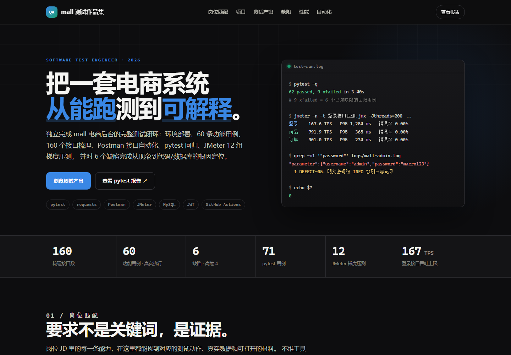

# mall 电商系统 · 软件测试作品集

**软件测试工程师 · 2026 届**  
从环境部署 → 功能测试 → 接口测试 → 性能压测 → 缺陷根因定位的完整闭环

> 本仓库不是"课程作业合集"，而是一次**真打包、真部署、真调接口、真压测**的完整测试实践。
> 所有数字都来自本机实测，报告中的每条结论都可以追溯到原始数据或代码。

**在线作品集**：<https://amytrd.github.io/mall-test-portfolio/>  
**GitHub 仓库**：<https://github.com/amytrd/mall-test-portfolio>



---

## 一分钟了解

| 维度 | 结果 |
|---|---|
| 被测系统 | mall 电商后台（Spring Boot 3 + MyBatis + MySQL 8 多模块项目） |
| 接口规模 | 从 OpenAPI 文档解析出 **160 个接口**，深度覆盖登录/商品/订单三大核心模块 |
| 功能测试 | **60 条用例**，综合运用等价类、边界值、场景法、错误推测法，**全部真实 HTTP 执行**，通过率 86.7% |
| 缺陷管理 | 发现 **6 个缺陷**（高危 4 / 中 1 / 低 1），全部完成根因定位与修复建议，并固化为 **xfail 回归用例** |
| 接口自动化 | Postman **40 个请求 / 约 130 条断言**；pytest 框架 **71 条用例**（62 passed + 9 xfailed） |
| 性能测试 | JMeter **12 组梯度压测**（20/50/100/200 并发），约 **30 万请求**，错误率 0% |
| 核心性能发现 | 登录接口存在 **约 167 TPS 的 CPU 吞吐上限**，查询类接口约 800–900 TPS，相差约 5 倍 |
| 数据可信度 | 用 **Little's Law（L=λW）** 交叉验证，理论值与实测值偏差 **< 3%** |

---

## 岗位要求 → 作品集证据

| 岗位要求 | 本作品集的对应证据 | 材料入口 |
|---|---|---|
| **测试理论**：黑盒/白盒、等价类、边界值、场景法、错误推测 | 60 条功能用例按方法分类；白盒思维来自阅读 `WebLogAspect`、DTO 校验注解、全局异常处理器源码后定向设计用例 | [功能测试报告](docs/reports/functional-testing.md) |
| **缺陷生命周期** | 6 个缺陷均记录：发现 → 复现 → 根因 → 修复建议 → xfail 回归 → 修复后转正；附状态流转说明 | [缺陷报告](docs/reports/defect-report.md) |
| **实际项目测试经验 + 产出物** | 用例、Bug 报告、测试报告、Postman 集合、JMeter 脚本、pytest 框架全部可查 | [交付物导航](#交付物导航) |
| **SQL 增删改查 + 多表查询** | 商品-品牌-分类三表关联、订单-订单明细对账、`information_schema` 字符集排查、事务内 UPDATE/ROLLBACK 安全验证 | [SQL 与日志分析](docs/reports/sql-and-log-analysis.md) |
| **Linux 常用命令 / 日志定位** | `grep`/`tail`/`awk`/`du`/`ss`/`journalctl` 命令对照；真实用日志定位 emoji 500 与明文密码缺陷 | [SQL 与日志分析](docs/reports/sql-and-log-analysis.md) |
| **Python / Java / JS 脚本能力** | 独立编写 pytest + requests + PyYAML 四层框架（配置层/工具层/数据层/用例层），71 条用例 | [自动化测试框架](docs/reports/automation-testing.md) |
| **Selenium/Appium/JMeter/Postman/Charles/Fiddler** | 熟练使用 **JMeter**、**Postman**；pytest 接口自动化；未使用 Selenium/Appium（不以未做过的工具充数） | [接口测试](docs/reports/api-testing.md) · [性能测试](docs/reports/performance-testing.md) |
| **HTTP 协议 + 接口测试流程** | 状态码/方法/Header/JWT/Content-Type 全覆盖；识别出"HTTP 全 200、真实结果在业务码"的项目特性 | [接口测试报告](docs/reports/api-testing.md) |
| **课程/竞赛/个人/开源项目测试经历** | 本项目为个人独立完成的完整测试实践，代码与数据全部保留 | 本仓库 |
| **加分：自动化框架（Pytest）** | pytest 四层框架 + session 级 token fixture + 数据驱动 + xfail 缺陷回归 | [自动化测试框架](docs/reports/automation-testing.md) |
| **加分：性能测试 / 接口自动化** | JMeter 12 组梯度压测、Little's Law 校验、瓶颈定位；Postman 五层断言 + token 关联 | [性能测试报告](docs/reports/performance-testing.md) |
| **加分：Git / CI/CD** | 仓库含 GitHub Actions：PR 静态校验（用例可发现性 + 资产合法性）；手动触发可对指定环境跑全量接口回归 | [`.github/workflows/ci.yml`](.github/workflows/ci.yml) |
| **加分：GitHub / 博客 / 测试作品集** | 本仓库 + GitHub Pages 在线作品集 | `docs/index.html` |

---

## 项目背景

被测系统 **mall** 是一套基于 Spring Boot 3 的多模块电商系统：

```
mall-admin   后台管理端   :8080   ← 本次功能/接口/性能测试的主目标
mall-portal  前台会员端   :8085   ← 完成部署与连通性验证
mall-search  搜索服务     :8081   ← 因缺少 Elasticsearch + 配置错误未部署（已定位）
```

依赖中间件：MySQL 8、Redis、MongoDB、RabbitMQ、Elasticsearch（缺失）。
数据库 `mall` 共 **76 张表**，含 38 个商品、65 笔订单、12 个品牌等真实业务数据。

> 被测系统为开源项目 [macrozheng/mall](https://github.com/macrozheng/mall)，本仓库只包含**测试资产与测试报告**，不包含被测系统源码。

---

## 测试流程

```
环境勘察          部署验证          功能测试          接口测试          性能压测          缺陷闭环
─────────      ─────────      ─────────      ─────────      ─────────      ─────────
依赖矩阵    →   打包/启动    →   60 条用例   →   Postman    →   JMeter     →   根因定位
端口检查        健康检查         等价类/边界     五层断言       12 组梯度       修复建议
配置 diff       接口解析         错误推测         接口关联       Little's Law    xfail 回归
```

---

## 六个缺陷（按严重程度）

| 编号 | 标题 | 级别 | 发现阶段 | 核心影响 |
|---|---|---|---|---|
| **DEFECT-05** | 日志切面记录**明文密码与完整 Token** | 🔴 高 | 性能测试后核查日志 | 任何能读日志的人可拿到全站凭据 |
| **DEFECT-06** | utf8mb3 列遇 emoji 触发 SQL 错误 1267 | 🔴 高 | 写 pytest 框架时 | 全库 **211 个列**受影响，可稳定触发 500 |
| **DEFECT-01** | 未处理异常被 `/error` 二次分发，真实错误被 401 覆盖 | 🔴 高 | 功能测试 | 状态码与响应体自相矛盾，掩盖其他缺陷 |
| **DEFECT-02** | 原始 SQL 错误信息直接返回客户端 | 🔴 高 | 功能测试 | 泄露数据库类型、SQL 片段、出错行号 |
| **DEFECT-04** | API 文档根路径白名单失效，带 token 反而 403 | 🟡 中 | 接口测试 | 文档不可用，排障成本增加 |
| **DEFECT-03** | 删除不存在的记录返回笼统「操作失败」 | 🟡 低 | 功能测试 | 语义不明，无法区分"不存在"与"删除失败" |

**两个"计划外发现"** 是这份作品集最有价值的部分：

- **DEFECT-05**：压测后发现日志文件涨到 **1.84 GB**，顺着日志内容才发现 `WebLogAspect` 以 INFO 级别打印了完整请求体和响应体，其中包含 `"password":"macro123"` 和完整 JWT。
- **DEFECT-06**：写 pytest 字符集边界用例时，传了一个 emoji 🔒，服务端返回 500。通过「3 字节中文正常 / 4 字节 emoji 报错」对照实验 + `information_schema` 查询，定位到 MySQL 5.7 时代遗留的 utf8mb3 列。

---

## 性能核心发现

| 接口 | 并发 20 → 200 的 TPS | 200 并发 P95 | 瓶颈判断 |
|---|---|---|---|
| `POST /admin/login` | 136 → **167.6**（50 并发后基本不再增长） | **1,284 ms** | **CPU 饱和**：BCrypt 密码校验 |
| `GET /product/list` | 753 → **791.9** | 365 ms | 索引查询，约 800 TPS 触顶 |
| `GET /order/list` | 856 → **901.0** | 234 ms | 索引查询，约 900 TPS 触顶 |

**关键判断**：三个接口同 JVM、同 Tomcat、同连接池、同 MySQL，唯一变量是接口实现。登录接口并发翻 4 倍而 TPS 恒定、延迟近似线性上升，是典型的资源饱和特征；查询类接口能达到登录的 5 倍，排除容器/网络/数据库基础设施瓶颈。

**数据自洽性**：用 Little's Law 验证 200 并发档，登录/商品/订单的理论响应时间与实测偏差分别为 2.8% / 0.9% / 0.6%。

> 完整数据、方法返工记录与局限性说明见 [性能测试报告](docs/reports/performance-testing.md)。

---

## 自动化与工程化

| 层 | 技术栈 | 入口 | 作用 |
|---|---|---|---|
| 环境层 | PowerShell | `test-artifacts/pytest/` 同级脚本说明 | 一键拉起服务、24 项环境自检 |
| 接口层 | Python 3.11 + pytest + requests + PyYAML | `test-artifacts/pytest/` | 71 条用例，session 级 token 复用，xfail 缺陷回归 |
| 性能层 | JMeter 5.5 + PowerShell | `test-artifacts/jmeter/` | 参数化梯度压测、稳态区间统计、HTML 报告 |
| CI | GitHub Actions | `.github/workflows/ci.yml` | PR 静态校验；手动触发对指定环境跑全量回归 |

**pytest 框架分层**：`config.py`（配置层）→ `utils/`（工具层）→ `data/`（数据层）→ `testcases/`（用例层）。环境地址、账号全部支持环境变量覆盖，便于切换本地 / 测试环境 / CI。

---

## 交付物导航

| 交付物 | 说明 |
|---|---|
| [测试计划](docs/reports/test-plan.md) | 范围、策略、环境、进度、风险、准入准出 |
| [功能测试用例与执行](docs/reports/functional-testing.md) | 60 条用例、执行结果、设计方法、缺陷关联 |
| [缺陷报告](docs/reports/defect-report.md) | 6 个缺陷的标准 Bug 报告：环境/步骤/预期/实际/根因/修复/状态 |
| [接口测试报告](docs/reports/api-testing.md) | 160 接口清单、Postman 40 请求、五层断言、token 关联 |
| [Postman 使用说明](docs/reports/postman-guide.md) | 集合导入、环境切换、执行顺序、结果解读与排错 |
| [功能测试执行结果 CSV](test-artifacts/functional-test-results.csv) | 60 条用例逐条实际结果，可筛选统计 |
| [性能测试报告](docs/reports/performance-testing.md) | 12 组压测数据、Little's Law、瓶颈分析、调优建议、局限性 |
| [自动化测试框架](docs/reports/automation-testing.md) | pytest 分层设计、fixture 污染案例、xfail 缺陷闭环 |
| [SQL 与日志分析](docs/reports/sql-and-log-analysis.md) | 多表查询、字符集排查、Linux 日志定位命令 |
| [测试复盘](docs/reports/retrospective.md) | 做对了什么、走了哪些弯路、下一步改进 |
| [简历项目描述](resume/简历项目描述.md) | 可直接粘贴到简历的 STAR 条目 |
| [面试问答](resume/面试问答.md) | 高频追问与回答要点 |
| `test-artifacts/postman/` | Postman 集合 + 环境变量 |
| `test-artifacts/jmeter/` | 3 个 JMX 脚本 + 账号 CSV + 稳态汇总 CSV |
| `test-artifacts/pytest/` | pytest 框架源码（配置/工具/数据/用例） |
| `docs/evidence/` | pytest HTML 报告 + JMeter 200 并发 HTML 报告（在线可看） |

---

## 在线作品集部署

1. 新建 GitHub 仓库，例如 `mall-test-portfolio`，将本目录推送到 `main` 分支。
2. 仓库 **Settings → Pages**：
   - Source 选择 **Deploy from a branch**
   - Branch 选择 `main`，目录选择 **`/docs`**
3. 等待 1–2 分钟，访问 `https://amytrd.github.io/mall-test-portfolio/`。
4. 本仓库已配置为 `amytrd`；如果你 fork 或改名，请同步替换 README 与 `docs/index.html` 中的用户名。

> 报告页由 GitHub Pages 内置的 Jekyll 渲染 Markdown，无需本地构建。
> 本地预览：`cd docs; python -m http.server 8000`（Markdown 报告页需部署后由 Jekyll 渲染）。

---

## 复现说明

```powershell
# 1) 启动被测系统（需要 mall 源码与中间件，本仓库不含）
# 2) 运行 pytest 接口自动化
cd test-artifacts/pytest
pip install -r requirements.txt
pytest --html=reports/report.html --self-contained-html

# 3) 运行 JMeter 压测（需已安装 JMeter 5.5）
cd test-artifacts/jmeter
jmeter -n -t "登录接口压测.jmx" -Jthreads=200 -Jramp=10 -Jloops=-1 -Jduration=45 -l result.jtl

# 4) 切换被测环境
$env:MALL_ADMIN_BASE = "http://test-server:8080"
$env:MALL_ADMIN_USER = "admin"
$env:MALL_ADMIN_PASS = "******"
```

---

## 声明

- 本仓库所有测试数据均为**本机实测**，未做美化；性能报告的局限性章节保留了"压测机与被测服务同机"等真实约束。
- 测试账号 `admin / macro123` 为开源项目 **mall 的默认演示账号**，仅用于本地测试环境。
- 仓库已排除虚拟环境、`__pycache__`、227 MB 运行日志等不适合公开的产物；日志片段中的 IP 与 Token 已脱敏。
- 被测系统版权归原作者所有，本仓库仅用于个人求职作品展示。
